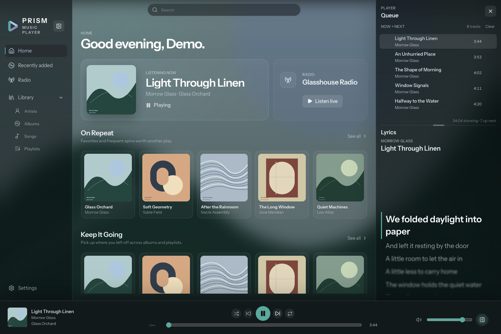
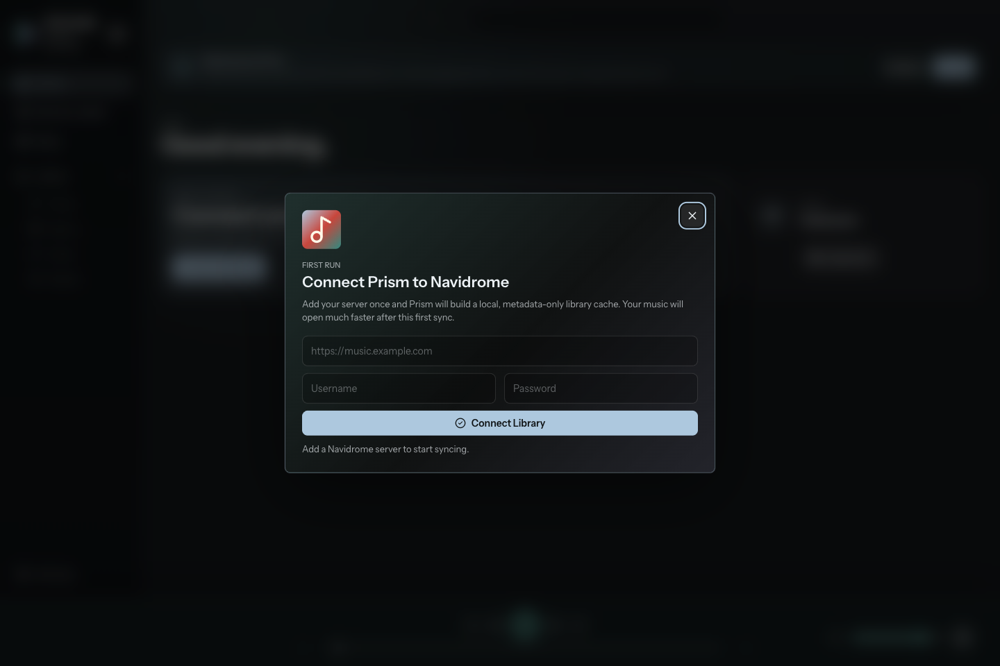
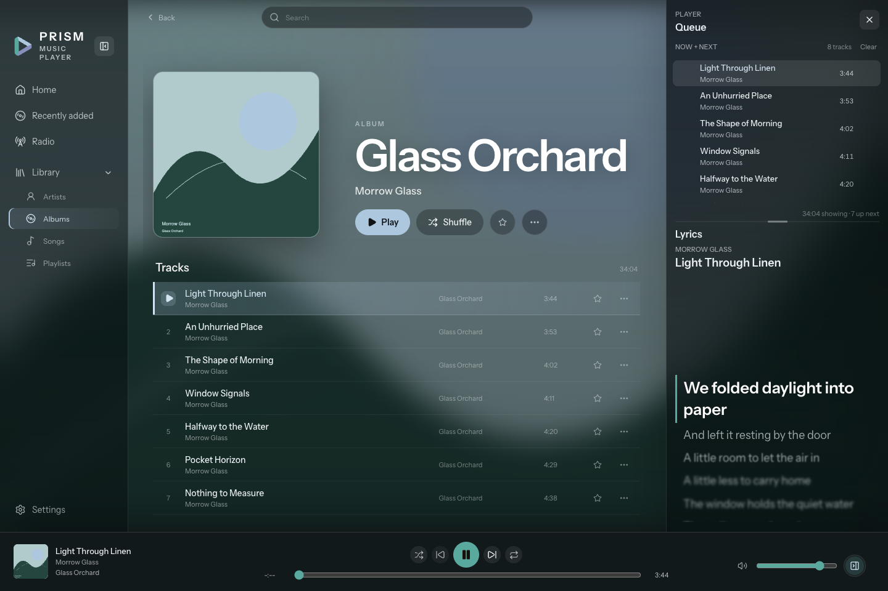
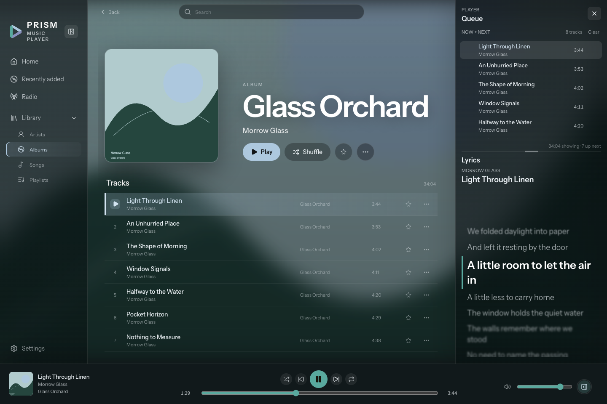
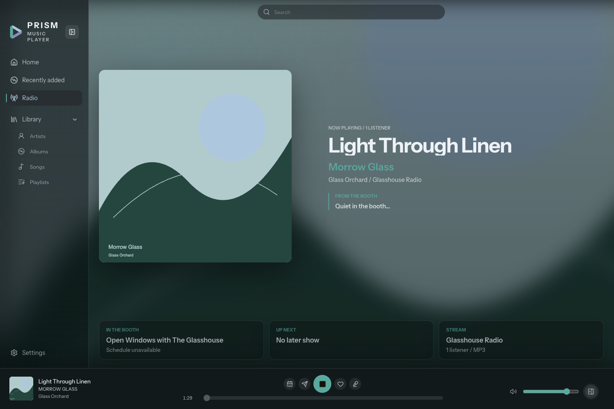

# Prism Player

**A desktop player for the music server you already use.**

Prism connects to Navidrome and other Subsonic-compatible servers, so you can play your library, manage the queue, and keep your playlists in one proper desktop app. If you use Subwave too, radio lives right there with the rest of your music.

Prism Player 1.1 is available for macOS, Windows and Linux (AppImage/DEB).

> **Need help or want to talk about Prism?** [Join the Discord](https://discord.gg/hzeAqu7EwF). It is the quickest place for questions, ideas, and bug reports.

## Get Prism

Grab the installer for your platform from the [latest GitHub release](https://github.com/kylejschultz/prism-player/releases/latest). Prism's macOS installer is signed and notarized, its Windows installer is code-signed, and Linux downloads are provided as AppImage and DEB packages. SHA-256 checksums are included with the downloads. Windows SmartScreen may still show a warning while Prism's new signing certificate establishes its reputation; download only from the official releases page and verify the publisher before opening it.

## First connection

1. Open Prism.
2. Enter the address of your Navidrome or other Subsonic-compatible server.
3. Sign in, then listen to your library.

Once you're connected, Prism gives you a simple place to browse the artists, albums, and music already on your server.

## Subwave Radio

Prism can tune into a Subwave station right alongside your library.

1. Open *Settings* and select *Radio*.
2. Under *Subwave channels*, add your station address, such as `https://subwave.example.com`.
3. Return to the *Radio* item in the sidebar, select the station, and choose *Tune In*.
4. While listening, you can check the schedule and booth feed, request a song, like the current track, or stop the stream.

Prism checks that the address is a Subwave station before connecting. You can save more than one station and switch between them later.

Once you're tuned in, Prism shows what is playing and keeps the station controls close by. Use the request button when you want to send something to the station.

## Contributing

Want to work on Prism? Development setup, branches, tests, and release notes are in [CONTRIBUTING.md](CONTRIBUTING.md).

## More screenshots

Open the screenshot gallery

Click any screenshot to open it full size.

## Features at a glance

- Navidrome and Subsonic server support.
- Artists, albums, playlists, favorites, recently added, and recently played views.
- A proper queue, plus shuffle, repeat, seeking, and volume controls.
- Search for artists, albums, songs, and playlists.
- Playlist editing and favorites.
- Subwave radio with now-playing, schedules, requests, likes, and booth updates.
- Queue or Radio timeline above lyrics in one sidebar, with an adjustable divider.
- Synced lyrics follow library playback and supported Subwave stations when the server or station supplies timestamps, with plain lyrics as a fallback. See [lyrics support](docs/LYRICS.md).

## Privacy

Prism stores your server connection and playback preferences locally. Optional anonymous analytics are opt-in. They only include app and install details, plus aggregate library counts; they do not include your account or playback data.

Discord Rich Presence is also opt-in and desktop-only. When enabled, Prism sends the current local track or Subwave radio track, artist, album, station, and playback state directly to the Discord app running on the same device. Prism does not use a Discord bot, server integration, account token, or client secret.

## License

[GNU General Public License v3.0](./LICENSE) — free to use, modify, and share. If you distribute a modified version, it needs to stay under the same license.

Instrument Sans is bundled under the [SIL Open Font License 1.1](src/assets/fonts/OFL.txt), with its copyright notice available in Settings → About → Typography & licenses. The font loads locally; no font-service connection or license key is required. [Font source and provenance](src/assets/fonts/README.md).
